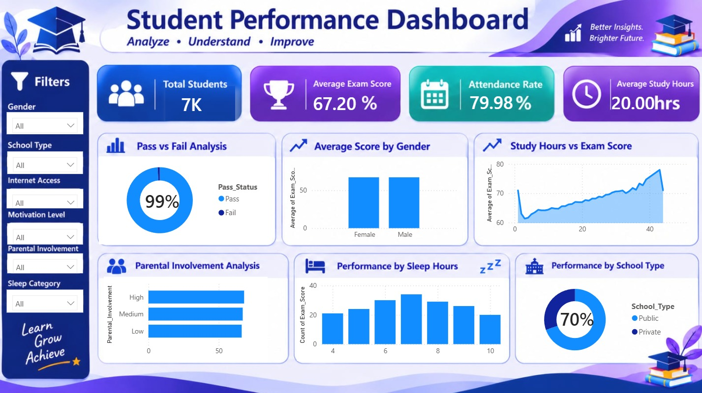

# Student Performance Analysis

A Data Analytics project exploring student academic performance and factors associated with exam scores.

## Project overview

This repository contains a cleaned student dataset, a Jupyter Notebook for analysis, a Power BI report, and a PDF project report. The analysis examines academic and contextual variables such as study hours, attendance, previous scores, sleep, tutoring, motivation, access to resources, and exam performance.

## Repository contents

```text
Students-Performance-Analysis/
├── Dataset/
│   └── StudentPerformance_Cleaned.csv
├── Python/
│   └── Student_Performance_Analysis.ipynb
├── PowerBI/
│   └── Student_Performance_Dashboard.pbix
├── Reports/
│   └── Student_Performance_Report.pdf
├── Screenshots/
│   └── Dashboard.jpg
├── outputs/                  # Generated exports (created when notebook runs)
├── README.md
├── requirements.txt
└── .gitignore
```

## Dataset

- File: `Dataset/StudentPerformance_Cleaned.csv`
- Records: 1,000
- Fields: 27
- Includes exam scores, attendance, study hours, previous scores, and derived categorical fields such as `Performance`, `Attendance_Category`, and `Pass_Status`.

**Data availability note:** The original pre-cleaning CSV was not available when this repository was packaged. The included notebook uses the cleaned CSV supplied here. Consequently, the original raw-data cleaning process cannot be fully reproduced from this repository alone.

## Tools and technologies

- Python
- Jupyter Notebook
- Pandas and NumPy
- Matplotlib and Seaborn
- Microsoft Power BI

## Getting started

### 1. Clone the repository

```bash
git clone https://github.com/<your-username>/Students-Performance-Analysis.git
cd Students-Performance-Analysis
```

### 2. Create and activate a virtual environment (recommended)

Windows:

```bash
python -m venv .venv
.venv\Scripts\activate
```

macOS/Linux:

```bash
python3 -m venv .venv
source .venv/bin/activate
```

### 3. Install dependencies

```bash
pip install -r requirements.txt
```

### 4. Run the notebook

```bash
jupyter notebook
```

Open `Python/Student_Performance_Analysis.ipynb` and run the cells from top to bottom. If you launch Jupyter from the repository root, the notebook finds the dataset automatically. It also checks the parent directory if launched from the `Python` folder.

### 5. Open the Power BI dashboard

Open `PowerBI/Student_Performance_Dashboard.pbix` using Microsoft Power BI Desktop. If Power BI prompts for a data source, update the source path to the CSV in the `Dataset` folder and confirm that the dashboard visuals reflect the included 1,000-row dataset before relying on dashboard totals.

## Dashboard preview



## Project report

See [`Reports/Student_Performance_Report.pdf`](Reports/Student_Performance_Report.pdf) for the accompanying report.

## Notes

- Generated CSV/Excel exports are saved in the `outputs/` folder.
- The `.gitignore` excludes notebook checkpoints, virtual environments, and temporary files.
- Check that all visuals and KPIs in the Power BI file correspond to the included dataset before presenting the dashboard publicly.

## Author

**Sujal Patil**  
linkedin.com/in/sujal-patil-844947294/ 
github.com/sujal45patil
